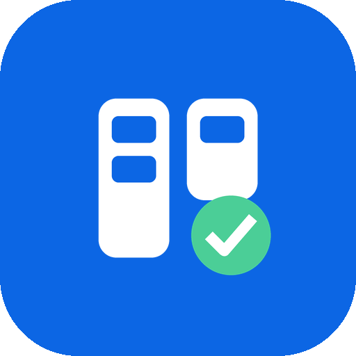

<p align="center"></p>

# Demandas

App Android para organizar demandas no estilo Trello, feito para o celular. Tudo fica salvo **localmente** no aparelho, sem servidor.

## 📲 Baixar o APK

**[⬇ Baixar a versão mais recente](https://github.com/VictorLanes/tarefas-app/releases/latest/download/Demandas.apk)**

1. Abra o link acima no celular e baixe o `Demandas.apk`.
2. Toque no arquivo baixado. Se o Android pedir, permita "Instalar apps desconhecidos" para o navegador/gerenciador de arquivos.
3. Ao abrir o app, crie sua conta e permita as notificações.

Cada `push` na branch `main` gera um APK novo automaticamente (aba **Actions** → *Gerar APK*, e também em **Releases**). Todos os APKs têm a mesma assinatura, então a nova versão instala **por cima** da antiga sem perder os dados.

## Funcionalidades

- **Login local** com usuário e senha (senha protegida com PBKDF2), opção "manter conectado", dica de senha e várias contas no mesmo aparelho
- **Quadros → listas → cartões**, com cores, favoritos e arquivamento
- **Arrastar e soltar**: segure um cartão e arraste para outra lista; arraste listas pelo ícone ⋮⋮
- **Cartões** com prazo, prioridade (baixa → urgente), etiquetas coloridas, descrição com links, checklist com progresso e comentários
- **Notificações**: lembrete antes do prazo (5 min a 2 dias) e aviso na hora; botões "Concluir" e "Adiar 15 min" direto na notificação; continuam funcionando após reiniciar o celular
- **Demandas recorrentes** (todo dia / semana / mês): ao concluir, a próxima é criada sozinha
- **Lista de concluídos**: mover um cartão para ela marca como concluído automaticamente
- **Agenda**: atrasadas, hoje, amanhã, próximos 7 dias, sem prazo
- **Histórico** de tudo o que foi feito, filtrável por quadro, e atividade de cada cartão
- **Busca** em todos os quadros e **filtros** por texto, prioridade, prazo e etiqueta
- Painel com pendentes, atrasadas, para hoje e concluídas na semana
- Tema claro, escuro ou automático
- **Backup**: exportar/importar `.json` (compartilhe para o Drive, WhatsApp, e-mail...)

## Tecnologia

- HTML/CSS/JavaScript puro em `src/`, empacotado com **esbuild** em `www/`
- **Capacitor 8** para gerar o app Android (`android/`)
- Plugins: Local Notifications, Preferences (armazenamento), App, Haptics, Filesystem, Share
- **SortableJS** para arrastar e soltar
- Build do APK no **GitHub Actions** (`.github/workflows/build-apk.yml`)

## Desenvolvimento (se um dia tiver um PC)

```bash
npm install
npm run dev        # abre em http://localhost:8080 no navegador
npm run sync       # gera o web e copia para o projeto Android
npx cap open android
```

## Observações

- Os dados ficam só no celular. **Desinstalar o app apaga tudo**, então use Ajustes → Exportar backup de vez em quando.
- Esqueceu a senha? Como não há servidor, não dá para redefinir. Use a dica de senha.
- Se os lembretes atrasarem, vá em Ajustes → "Alarmes exatos" e libere, e tire o app da economia de bateria do Android.
